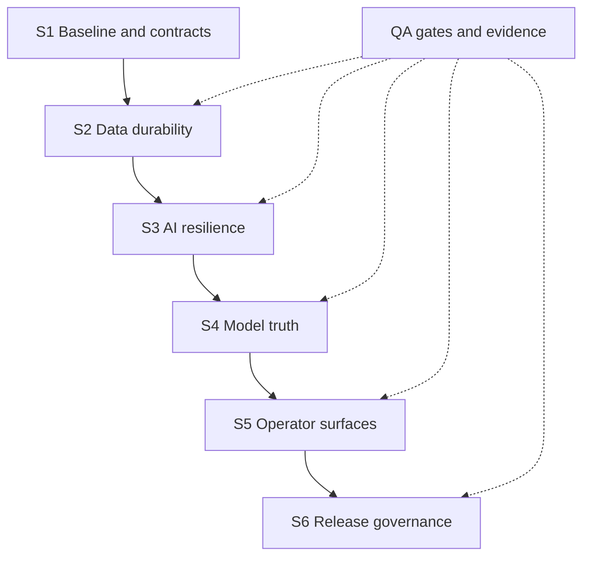

# AlphaSentinel 12-Week Balanced Delivery Charter

> **Status:** Approved for execution by the Project Manager; G0 QA custodian countersignature pending · **Version:** 1.2 · **Effective:** 2026-10-29
> **Owner:** Project Manager (coordination only) · **Custodian:** Principal QA/QC/Automation Engineer
> **Horizon:** Six two-week sprints, Weeks 1–12

## 1. Charter Metadata

| Field | Value |
|---|---|
| Document title | AlphaSentinel 12-Week Balanced Delivery Charter |
| Artifact | `docs/governance/PROJECT_CHARTER.md` |
| Version | 1.2 |
| Status | Approved for execution by the Project Manager. Publication is complete only when the QA custodian countersigns at G0; that countersignature is pending. |
| Effective date | 2026-10-29 |
| Horizon | 12 weeks, six two-week sprints. Week numbers are binding; calendar dates are fixed at Sprint 1 planning. |
| Deployment target | Docker Compose on a single host |
| Document owner | Project Manager — coordination, sequencing, and acceptance only |
| Document custodian | Principal QA/QC/Automation Engineer — publication, gate evidence, and currency |
| Approval | The Project Manager approves content and authorizes execution. The QA custodian countersigns publication at G0. Execution authority and publication completeness are separate states. |
| Change control | Section 15 |
| Review cadence | Weekly risk review; every sprint-exit gate; formal analyst reviews in Weeks 8 and 10 |
| Supersedes | None — first charter for this horizon |
| Precedence | Invariants (Section 5) > this charter > sprint plans > working notes. Precedence takes effect at PM approval; the G0 countersignature governs publication status, not precedence. |

**Status model.** Two states are tracked separately and are never merged in prose:

- **Approved for execution** — the Project Manager has approved the content, and the charter binds planning, sequencing, and gate decisions. This state is in force for version 1.2.
- **Published** — the QA custodian has countersigned at G0 after the Week 1 currency check. This state is pending. Until it is recorded, the charter is authoritative for execution but is not a completed publication, the Section 20.2 review record reads "pending", and G0 stays open.

If the custodian declines to countersign, G0 fails and the PM records a RAID entry. Execution authority does not lapse, but no gate may cite the charter as a published baseline until the defect is corrected and countersigned.

## 2. Purpose and Decision Frame

This charter is the single authoritative decision record for the next 12 weeks. It fixes what success means, who owns what, which interfaces may change and how, which gates must pass, and what "done" means at the end. It is decision-complete by design: a question is either answered here, assigned in Section 19 with an owner and a deadline, or explicitly excluded in Section 6.2.

The charter is not a design document, a sprint backlog, or a forecast of model performance. Design detail belongs to the owning principal; estimates belong to the sprint plan; performance claims belong to measured evidence (Section 11).

### 2.1 Balance Rule

**Schedule is fixed. Scope is variable. Quality and invariants are not.**

When a sprint is at risk, the Project Manager removes scope by displacement (Section 15.3). No invariant in Section 5 may be traded for schedule, and no KPI target may be asserted without a named source. A release that is late is recoverable; a release that silently weakens a veto, a budget gate, or a data contract is not.

### 2.2 Reading Paths

| Reader | Read first | Then |
|---|---|---|
| Project Manager | 1, 10, 13, 14, 15, 19 | 18 |
| Engineering principals | 5, 7, 8, 9, 16, 17 | 10, 11 |
| Principal Data Analyst | 3, 8, 11, 14 | 18 |
| Reviewer or auditor | 5, 6, 16, 18, 20 | 13 |

## 3. Business Outcomes

Six outcomes define success. Each is stated as something that can be observed or reproduced during the horizon — not as a projected number.

| ID | Business outcome | Why it matters | Evidence that it is achieved |
|---|---|---|---|
| BO-1 | Unattended operational resilience | The scanner must be trustworthy when nobody is watching; a silent stall is the worst possible failure mode. | Induced stale and hung cycles produce a non-zero `python -m bot.main --health` result and an observable alert; a seven-day soak completes with fresh cycles and no manual restart. |
| BO-2 | Bounded, observable LLM cost | An unattended service with an open-ended bill is not operable. | Zero spend-ceiling breaches during the soak; every exhaustion event produces an explicit degraded result, never a silent skip; spend is visible in operator status and the dashboard. |
| BO-3 | Measurable model quality | A model without a reproducible evaluation is an opinion with a filename. | A second engineer reproduces time-split metrics, calibration, and escalation coverage within an agreed tolerance; numeric targets are approved only after the Week 7–8 baseline. |
| BO-4 | Explainable, reproducible verdicts | Operators must justify a decision after the fact, and auditors must be able to recompute it. | Every verdict resolves deterministically through `core/scoring.py`; layer-level evidence and veto reasons are reachable in one dashboard flow; replaying the same inputs yields the same decision. |
| BO-5 | Repeatable, reversible releases | A release that cannot be undone is a one-way door. | One tagged release completes the full checklist; the rollback rehearsal restores service and data without a schema downgrade. |
| BO-6 | Recoverable data and incidents | Retention without proof is deletion with extra steps. | The retention dry-run reports zero unexplained rows; two consecutive restores succeed; one incident drill closes with owned actions. |

## 4. Assumptions

| ID | Assumption | If false | Confirmed by |
|---|---|---|---|
| A-1 | The horizon is 12 weeks and six two-week sprints. | Scope is reduced by displacement; the horizon does not extend silently. | PM, Sprint 1 planning |
| A-2 | The seven principals are available part-time, not full-time. | PM sequences to the critical path and defers non-blocking deliverables; invariants are never deferred. | PM, Week 1 |
| A-3 | Docker Compose on a single host remains the deployment target. | Any orchestration change requires a charter amendment and is out of scope. | PM + QA, Week 1 |
| A-4 | CI remains credential-free and hermetic; no live provider calls in CI. | Tests that need live providers are rejected; the suite is not weakened to accommodate them. | QA, Week 1 audit |
| A-5 | ML quality thresholds are derived from measured baselines, never preset. | The model workstream reports baselines only; no numeric target is approved. | ML + Analyst, Week 8 |
| A-6 | The hot SQLite store (schema version 3) and the Parquet lake remain the systems of record. | A storage re-architecture is out of scope and requires an amendment. | Data Eng, Week 1 |
| A-7 | Historical data is sufficient to measure a baseline but is not assumed complete. | Gaps are recorded as gaps; values are not imputed or estimated. | Analyst + Data Eng, Week 2 |
| A-8 | Provider API contracts may change during the horizon. | Adapters absorb the change; veto and scoring semantics do not move. | AI Eng, ongoing |
| A-9 | There is no 24×7 on-call rotation. | Incident response is business-hours best effort, documented as a limitation. | PM, Week 1 |
| A-10 | The existing suite is green at kickoff and is the regression baseline. | Sprint 1 exit cannot be claimed until it is green again. | QA, Week 1 |

## 5. Invariants and Enforcement

These ten invariants are the non-negotiable behavior of the platform. They are preserved from the current system and are guarded, not reinterpreted.

| ID | Invariant | Implementation anchor | Enforcement | Drift signal |
|---|---|---|---|---|
| INV-1 | Deterministic veto precedence: hard security flags → Agent 2 veto → risk score ≥ `MAX_RISK_SCORE` → wash-trading suspicion ≥ 85; first match wins. | `core/scoring.py` (`reconcile`), `tests/test_scoring.py` | Unit tests, QA guard, review of every scoring change | A new veto path, reordered checks, or an LLM-only veto. |
| INV-2 | Skipped and unavailable layers carry zero weight; silence is never bearish. | `core/scoring.py` (`weighted_prior`); zero total weight returns neutral 50.0 | Unit tests for zero-weight and neutral fallback | A skipped layer moving the score, or a sentinel value entering the mean. |
| INV-3 | Budget exhaustion must propagate. | `ai_engine/llm_client.py` (`LLMBudgetExceeded`), `bot/engine.py` (explicit `llm_budget_exhausted`, no verdict for unspent targets) | `tests/test_budget.py`; soak; fault injection | A swallowed exception, a fabricated verdict, or an unmarked skip. |
| INV-4 | Dependencies are pinned exactly. | `requirements.txt`, `requirements-ml.txt` | CI install, PR review | Ranges, `latest`, or unpinned transitive additions. |
| INV-5 | Tests are hermetic: no network, no real credentials. | `Makefile` (`test`), `setup.cfg`, CI with `DEMO_MODE=true` | `make test`; hermeticity audit | A test that requires a key, a socket, or a live provider. |
| INV-6 | Storage stays compatible and forward-additive. | `storage/hot_store.py` (`SCHEMA_VERSION`, migration path), `storage/parquet_store.py` (partitioned Parquet) | Migration and compatibility rehearsals; restore drills | A destructive rewrite, column rename, or a rollback image that cannot read current data. |
| INV-7 | Health is freshness-based, not process-based. | `bot/health.py`, `Dockerfile` `HEALTHCHECK` | `--health` exit codes; stale and hung drills | `--status` used as liveness, or a dead loop reported healthy. |
| INV-8 | The dashboard is read-only. | `dashboard/app.py` (cached readers only) | Code review; read-only tests | Any write path, mutation on refresh, or mutable control. |
| INV-9 | Production boot gates fail fast. | `config/settings.py` validation, `bot/main.py` exit 2, CI negative boot test | CircleCI `docker-build` job — the only live workflow that builds the image and asserts the boot gate (Section 16.1) | A production container that boots without `LLM_API_KEY` or with `DEMO_MODE=true`. |
| INV-10 | The LLM is never the sole source of truth. | `core/scoring.py` arithmetic; the LLM supplies narrative and risk input | Scoring tests; deterministic replay | A decision that cannot be recomputed without the model. |

An invariant may change only by charter amendment (Section 15), with a migration note, a rollback note, QA countersignature, and a guard that demonstrates the new behavior. Invariants are never waived for schedule.

## 6. Scope

### 6.1 In Scope

| Domain | Committed work | Domain lead | Sprints |
|---|---|---|---|
| AI engine | Bounded provider resilience, explicit budget-exhaustion handling, prompt version registry, offline drift replay, spend observability | Principal AI Engineer | S3 |
| Machine learning | Reproducible time-split evaluation, calibration and escalation analysis, model metadata, manual training runbook | Principal ML Engineer | S4 |
| Data analysis | KPI definitions and numerator/denominator contracts, model and prompt evaluation review, layer contribution analysis, dashboard reconciliation sign-off | Principal Data Analyst (read-only) | S1, S2, S4, S5 |
| Data engineering | Contract register, retention and compaction dry-run, R2 retry and idempotency, schema compatibility, backup and restore rehearsal | Principal Data Engineer | S1, S2, S4, S6 |
| Full stack | Read-only verdict drill-down, layer-signal inspection, export, KPI surfaces, freshness status | Principal Full-Stack Engineer | S5 |
| QA automation | Property, failure-path, load, security, and dashboard tests; `Makefile` gate targets behind `make ci`; CI quality gates on both providers; release and rollback evidence | Principal QA/QC/Automation Engineer | All |
| Project governance | RAID register, decision log, change control, sprint gates, release checklist, incident runbook, final acceptance | Project Manager | All |

Domain lead denotes technical or semantic leadership, not exclusive implementation. Accountable and responsible roles per workstream are fixed in Section 8.2.

### 6.2 Out of Scope

| Excluded item | Reason | Re-entry condition |
|---|---|---|
| Continual or online learning | No drift governance, rollback, or evaluation cadence for it; training stays manual. | Post-charter, after drift monitoring and reproducible evaluation are routine. |
| Kubernetes or multi-region deployment | Deployment target remains Docker Compose on one host. | Post-charter, with a measured availability need. |
| Mutable dashboard controls | Violates INV-8. | Only by amendment defining a write path and audit trail — not in this horizon. |
| New scanner families | Dilutes the quality workstream; existing coverage must stabilize first. | Post-charter, after coverage and baseline targets are met. |
| Additional alert channels | Alert efficacy is unmeasured; more channels add noise. | After alert efficacy is measured. |
| Preset predictive-performance targets | Would assert unmeasured quality. | Never preset; targets are derived in Weeks 7–8. |
| Breaking storage schema changes | Violates INV-6 and the rollback path. | Additive changes only; breaking changes need an amendment and a migration window. |
| LLM veto authority or veto delegation | Violates INV-1 and INV-10. | Not permitted. |

## 7. Deliverables

Each deliverable names one accountable owner. A role shown after a semicolon or plus is a required collaborator, not a co-owner. Implementation responsibility (`R`) is defined in Section 8.2: for file and contract work it always matches the path owner in Section 8.3, and governance activities with no file row name their implementing role explicitly in Section 8.2. "Governance register" means the artifact maintained by the QA custodian under `docs/governance/`; the custodian assigns its filename and version.

| ID | Deliverable | Definition of done | Evidence | Owner (accountable) | Sprint |
|---|---|---|---|---|---|
| DLV-01 | Ratified role mandates and RACI | Every role has a mandate, decision rights, and explicit exclusions; one owner per file or contract per delivery round | Section 8 signed at Sprint 1 review | PM | S1 |
| DLV-02 | KPI register | Every KPI has definition, numerator/denominator, source, measurement owner, semantics owner, and baseline status | Section 11 populated | Analyst (semantics); QA records | S1 |
| DLV-03 | Baseline measurement pack | Cycle duration, cycle success, test runtime, storage growth, daily spend, and dashboard query latency measured or marked UNMEASURED with method | Measurement records with command, window, and environment | QA; Data Eng collaborator | S1 |
| DLV-04 | Invariant guard inventory | Each of INV-1 through INV-10 mapped to an existing or planned guard; gaps listed with the sprint that closes them | Guard matrix | QA | S1 |
| DLV-05 | Contract register v1 | Shared models, settings keys, hot-store schema, Parquet datasets, prompt versions, and dashboard read contracts recorded with owners and consumers | One register entry per contract | Data Eng; AI Eng collaborator | S1 |
| DLV-06 | Boot-gate audit | Production missing-key exit 2, production `DEMO_MODE` rejection, and invalid-config rejection reproduced | Command transcript | QA | S1 |
| DLV-07 | Hermeticity audit across both CI providers | No test requires network, credentials, or a live provider; CircleCI and GitHub CI evidence attached | Audit record | QA | S1 |
| DLV-08 | RAID and decision log v1 | Risks, assumptions, issues, and dependencies with owner and mitigation; first decisions recorded | Section 13 plus decision log | PM | S1 |
| DLV-09 | Retention and compaction dry-run | Dry-run only, no deletion; row accounting where input = output + explained deletions; zero unexplained rows | Dry-run report | Data Eng | S2 |
| DLV-10 | R2 failure policy and implementation | Timeouts and 5xx retried within a bounded policy; not-found not retried; idempotent keys; no duplicate partitions | Fault-injection results | Data Eng | S2 |
| DLV-11 | Schema compatibility rehearsal | Current schema reads data written before and after an additive migration; the rollback image reads current data | Rehearsal record | Data Eng | S2 |
| DLV-12 | Backup and restore rehearsal | Two consecutive successful restores with verification queries | Restore log | Data Eng; QA collaborator | S2 |
| DLV-13 | Storage growth model and retention recommendation | Measured growth per day; proposed local and remote windows with rationale | Analysis and recommendation | Data Eng; Analyst collaborator | S2 |
| DLV-37 | Retention and compaction enable switch | Explicit, tested control that independently disables retention and compaction; safe default; documented operator procedure; rollback depends on it | Switch test and operator procedure | Data Eng | S2 |
| DLV-14 | Provider failure taxonomy and retry policy | Timeout, 5xx, 429, auth, malformed payload, and not-found classified; bounded retry and budget interaction defined | Policy plus tests | AI Eng | S3 |
| DLV-15 | Budget propagation evidence | Day and cycle ceilings enforced; exhaustion marked explicitly; no verdict fabricated; ledger reconciles | Test output and soak log | AI Eng; QA collaborator | S3 |
| DLV-16 | Prompt version registry | Current prompt version recorded; change rules, review, and rollback defined | Registry entry | AI Eng | S3 |
| DLV-17 | Offline drift replay harness | Recorded fixtures replay deterministically; differences reported without live calls | Harness and replay report | AI Eng; QA collaborator | S3 |
| DLV-18 | Spend observability in operator status | Today's spend, day cap, and cycle cap visible; a ledger read failure does not hide the rest of status | Status output | AI Eng | S3 |
| DLV-19 | Reproducible time-split evaluation | Fixed split, fixed features, recorded environment; a second engineer reproduces within tolerance under QA observation | Evaluation report, rerun record, and QA verification note | ML Eng | S4 |
| DLV-20 | Calibration report | Reliability by score band with the chosen metric and sample counts | Report | ML Eng; Analyst collaborator | S4 |
| DLV-21 | Escalation coverage report | Prior versus model predictor coverage by bucket; uncovered buckets named | Report | ML Eng; Analyst collaborator | S4 |
| DLV-22 | Model metadata manifest | Features, training window, data range or hash, metrics, environment, and prompt version | Manifest | ML Eng; Data Eng collaborator | S4 |
| DLV-23 | Manual training runbook | Preconditions, data export, training command, validation, promotion, and rollback; explicitly manual | Runbook | ML Eng | S4 |
| DLV-24 | Derived ML targets | Numeric targets derived from Week 7–8 evidence with method and source; analyst-approved | Target decision record | ML Eng; Analyst approval | S4 |
| DLV-25 | Verdict drill-down | From verdict list to layer-level evidence and veto reasons in one flow | Demo and tests | Full-Stack | S5 |
| DLV-26 | Layer-signal inspection and export | Signals inspectable; export has a frozen, documented schema | Schema document and export test | Full-Stack | S5 |
| DLV-27 | KPI tiles and freshness banner | Tiles reconcile with source queries; freshness state visible and honest | Reconciliation record | Full-Stack; Analyst semantics | S5 |
| DLV-28 | Dashboard reconciliation sign-off | Each KPI tile matches its source definition within agreed tolerance | Sign-off | Analyst (sign-off authority); PM records | S5 |
| DLV-29 | Read-only enforcement tests | No write path; refresh and export do not mutate; no mutable controls exposed | Test results | QA | S5 |
| DLV-30 | Property, load, and security suites | Recorded results with thresholds set from the Week 1–2 baseline | Suite results | QA | S5 |
| DLV-31 | Failure-path suite | Recorded results for provider faults, budget exhaustion, and storage failures; thresholds from the Week 1–2 baseline | Suite results | QA | S6 |
| DLV-32 | Coverage gap closure | Named gaps closed or accepted with owner and rationale | Coverage report | QA | S6 |
| DLV-33 | Release checklist executed | One tagged build completes every checklist item | Checklist and tag | PM; QA collaborator | S6 |
| DLV-34 | Rollback rehearsal | Image reversion, store restore, tested enable switch, and append-compatible read verified | Rehearsal record | QA; Data Eng collaborator | S6 |
| DLV-35 | Incident runbook and drill | Detection, triage, rollback, communication, and post-incident review; one drill executed | Runbook and drill record | PM; QA collaborator | S6 |
| DLV-36 | Final acceptance pack | Section 18 evidence assembled and countersigned | Acceptance record | PM; QA collaborator | S6 |

DLV-37 is allocated out of sequence to preserve existing identifiers; it is a Sprint 2 deliverable.

## 8. Ownership and Decision Rights

### 8.1 Role Mandates

Seven principals own the delivery. Human names are recorded in the decision log at kickoff; the role accountability below is binding regardless of who fills it.

| Role | Mandate | Decision rights | Explicitly excluded |
|---|---|---|---|
| Project Manager | Coordinate sequencing, ceremonies, RAID, change control, and acceptance — coordination only. Own the charter and the decision log. | Schedule, ceremony format, displacement decisions, acceptance recommendation, escalation. | No implementation, no code review authority, no unilateral scope change, no invariant waiver. |
| Principal AI Engineer | Own provider adapters, prompt versions, budget semantics, failure handling, and offline replay. | AI-internal design; retry and timeout policy within the charter. | No scoring or veto changes without an amendment; no unbounded retries; no live-provider tests in CI. |
| Principal ML Engineer | Own evaluation, calibration, escalation analysis, model metadata, and manual training. | Model and feature choices within the approved feature set; evaluation method. | No numeric target without analyst approval; no online learning; no silent feature-set expansion. |
| Principal Data Analyst | Own KPI semantics, numerator and denominator contracts, interpretation, model and prompt review, layer contribution analysis, and reconciliation sign-off. | KPI definitions, interpretation, and sign-off on reported numbers. | **Read-only:** no code writes, no data mutation, no configuration changes, no pipeline operation. |
| Principal Data Engineer | Own storage, schema, retention, compaction, R2 behavior, backup and restore, and the contract register. | Storage-internal design; additive schema changes; retention settings. | No breaking schema change alone; no deletion without dry-run and restore evidence. |
| Principal Full-Stack Engineer | Own read-only operator surfaces: drill-down, layer inspection, export, KPI tiles, and freshness status. | Dashboard layout and read queries. | No write path, no mutable controls, no new source of truth. |
| Principal QA/QC/Automation Engineer | Own independent verification, test architecture, CI gates, and governance custody. | Gate pass or fail, release block, document custody. | Cannot be sole implementer and verifier of the same change; cannot waive an invariant. |

**Independence rule.** The QA custodian verifies every behavior change, including changes authored inside the test suite. When QA implements tooling, another principal reviews it. No gate is self-certified by the role that produced the change.

### 8.2 Responsibility Matrix

`A` = accountable for the outcome, `R` = implementer, `C` = consulted, `I` = informed. One `A` per row. `R` is reserved for the role that performs the implementation. For a file or contract activity, `R` must equal the path owner in Section 8.3. For a governance or decision activity with no file row — charter and RAID upkeep, KPI register recording, release readiness, rollback rehearsal — `R` is the single role named in the row, and the verifier is the independent verifier named in the same row. A role that only reviews, approves, or signs off is `C` or `A`, never `R`. Independent verification is a separate lane so the verifier is never the implementer.

| Workstream | PM | AI Eng | ML Eng | Analyst | Data Eng | Full-Stack | QA | Independent verifier |
|---|---|---|---|---|---|---|---|---|
| Charter, RAID, ceremonies, change log | A/R | C | C | C | C | C | C | QA custodian |
| Shared contracts (`core/models.py`, `config/settings.py`) | I | C | C | C | A/R | C | C | QA |
| Scoring and veto (`core/scoring.py`) | I | A/R | C | C | C | I | C | QA |
| AI engine and prompts (`ai_engine/`) | I | A/R | C | C | I | C | C | QA |
| ML pipeline and evaluation (`ml/`) | I | C | A/R | C | C | I | C | QA |
| Storage, retention, R2 (`storage/`) | I | I | C | C | A/R | C | C | QA |
| Dashboard (`dashboard/app.py`) | I | I | I | C | C | A/R | C | QA |
| Test strategy, `Makefile` gate targets, and CI configs (`tests/`, `Makefile`, `.circleci/config.yml`, `.github/workflows/`) | I | C | C | C | C | C | A/R | Peer reviewer assigned by PM |
| KPI definitions and interpretation | C | C | C | A | C | C | R | PM (process check) |
| Release readiness decision | A/R | C | C | C | C | C | C | QA |
| Rollback rehearsal | I | C | C | I | C | C | A/R | Peer reviewer assigned by PM |

**Read-only guarantee.** The Analyst is `A` on KPI semantics and `R` nowhere. The Analyst never edits code, configuration, datasets, or governance files; the KPI register is recorded by the QA custodian under the Analyst's semantic authority.

**QA independence.** QA is `R` only for the test, `Makefile` gate-target, and CI artifacts it implements; no other role is `R` on those rows. Where QA implements, the independent verifier is a peer assigned by the PM. QA never verifies its own implementation, and never signs off another engineer's implementation as both implementer and verifier.

**PM scope.** The PM's `A/R` on governance and release readiness is coordination work — charter, RAID, ceremony records, and the release checklist — not technical approval or implementation. These rows have no Section 8.3 path row, so `R` is the role named in the row itself: PM for governance records and release readiness, the QA custodian for the KPI register, and the named owner for rollback rehearsal.

### 8.3 File and Contract Ownership

One owner per file or contract per delivery round. Review is not ownership. Where a row names a semantic authority, that role holds the `A` in Section 8.2 and does not edit the file. All three GitHub workflows are live and owned even though only `ci.yml` runs tests; Section 16.1 states what each one proves.

| Path or contract | Owner | Required reviewers | Independent verifier | Primary consumers |
|---|---|---|---|---|
| `core/models.py` | Data Eng | AI Eng, ML Eng, Analyst, QA | QA | All modules |
| `config/settings.py` | Data Eng | AI Eng, QA | QA | Bot, dashboard, ML |
| `core/scoring.py` | AI Eng | Analyst, QA, Data Eng | QA | Bot |
| `ai_engine/llm_client.py`, `ai_engine/prompts.py` | AI Eng | QA, ML Eng | QA | Bot, replay |
| `storage/hot_store.py` | Data Eng | QA, Full-Stack | QA | Bot, dashboard, ML |
| `storage/parquet_store.py` | Data Eng | QA, ML Eng | QA | Bot, ML, dashboard |
| `ml/` | ML Eng | Analyst, QA | QA | Bot predictor, dashboard |
| `dashboard/app.py` | Full-Stack | Analyst, QA | QA | Operators |
| `tests/` | QA | Owning engineer | Peer reviewer assigned by PM | CI |
| `.circleci/config.yml`, `Makefile` | QA | PM, Data Eng | Peer reviewer assigned by PM | CircleCI and local gates |
| `.github/workflows/ci.yml` | QA | PM, Data Eng | Peer reviewer assigned by PM | GitHub CI |
| `.github/workflows/codeql.yml` | QA | PM | Peer reviewer assigned by PM | GitHub security analysis |
| `.github/workflows/ai-review.yml` | QA | PM | Peer reviewer assigned by PM | GitHub advisory review |
| `.github/dependabot.yml` | Data Eng | QA | QA | Dependency automation |
| `requirements.txt`, `requirements-ml.txt` | Data Eng | QA, AI Eng, ML Eng | QA | All |
| `Dockerfile`, `docker-compose.yml` | Data Eng | QA, AI Eng | QA | Deployment |
| `docs/governance/PROJECT_CHARTER.md` | PM | QA custodian, all principals | QA custodian | All |
| KPI register (governance artifact) | QA custodian (records); Analyst semantic authority | PM, Analyst | PM | All |
| RAID and decision log | PM | QA | QA | All |
| Other governance registers | QA custodian | PM | PM | All |

## 9. Mandatory Cross-Domain Handoffs

A handoff is a written, versioned note. Verbal handoffs are invalid. Each note states the contract ID, version, compatibility class, consumer list, rollback note, and test evidence. The QA custodian audits completeness at every sprint-exit gate and records gaps in RAID.

| ID | Handoff | From → To | Required artifact | Blocking rule | Verified by |
|---|---|---|---|---|---|
| H-01 | Shared model or settings change | Data Eng → AI Eng, ML Eng, Full-Stack | Contract note with compatibility class, consumer list, and migration | Blocks merge; no silent key or field changes | QA |
| H-02 | Retention or compaction output into ML datasets | Data Eng → ML Eng | Row accounting plus dataset range statement | Blocks training or evaluation on the affected range | Analyst + QA |
| H-03 | Budget signal chain | AI Eng → Bot → Storage → Operator surfaces | Ledger semantics: what is counted, when, and how exhaustion is marked | Blocks any spend claim or KPI tile | QA |
| H-04 | Model metadata into operator KPIs | ML Eng → Full-Stack + Analyst | Metadata manifest plus KPI mapping | Blocks KPI tile release | Analyst |
| H-05 | Behavior change into independent verification | Any owner → QA | Change summary, risk, targeted tests, and revert note | Blocks sprint exit | PM |
| H-06 | Contract change notice | Owning engineer → all consumers + QA | Class A, B, or C change note with evidence | Blocks merge inside a freeze window | QA |
| H-07 | KPI definition change | Analyst → all owners | Updated numerator, denominator, source, and effective sprint | Blocks any reporting change | PM |
| H-08 | Release candidate | QA → PM | Gate evidence bundle | Blocks acceptance | PM |
| H-09 | Incident findings | Any role → owners + custodian | Post-incident actions with owners and dates | Blocks gate closure | QA |
| H-10 | Rollback plan for a data-affecting change | Data Eng → QA + PM | Restore path, the tested retention and compaction enable switch (DLV-37), and a compatibility statement | Blocks production enablement | PM |

## 10. Sprint Plan (Weeks 1–12)

### 10.1 Sprint Calendar

| Sprint | Weeks | Theme | Primary outcome | Gate |
|---|---|---|---|---|
| S1 | 1–2 | Baseline and contracts | Ownership, interfaces, and measured baselines frozen | G1 |
| S2 | 3–4 | Data durability | Retention, restore, schema, and R2 behavior proven | G2 |
| S3 | 5–6 | AI resilience | Provider failure and spend exhaustion are explicit and bounded | G3 |
| S4 | 7–8 | Model truth | Reproducible evaluation and derived, approved targets | G4 |
| S5 | 9–10 | Operator surfaces | Read-only evidence flow with reconciled KPIs | G5 |
| S6 | 11–12 | Release governance | Release, rollback, and acceptance evidence complete | G6 |

Sprints are sequential: sprint n+1 opens only after gate Gn passes. Sprint 3 therefore occupies Weeks 5–6 and cannot overlap Sprint 2; Section 12 shows the same chain.

### 10.2 Sprint 1 — Baseline and Contracts (Weeks 1–2)

**Objective.** Freeze the decision surface: who owns what, which interfaces exist, what the current baseline actually is, and which invariants already have guards.

| Work | Owner | Evidence |
|---|---|---|
| DLV-01 Role mandates and RACI | PM | Signed matrix |
| DLV-02 KPI register | QA records; Analyst semantics | Populated Section 11 |
| DLV-03 Baseline measurement pack | QA; Data Eng collaborator | Measurement records |
| DLV-04 Invariant guard inventory | QA | Guard matrix |
| DLV-05 Contract register v1 | Data Eng; AI Eng collaborator | Register entries |
| DLV-06 Boot-gate audit | QA | Command transcript |
| DLV-07 Hermeticity audit across both CI providers | QA | Audit record |
| DLV-08 RAID and decision log v1 | PM | Register v1 |
| Ceremony calendar and gate owners confirmed | PM | Decision log entry |

- **Entry:** G0 satisfied — the PM approval is recorded and the QA custodian has countersigned during Week 1; repository baseline green; all seven roles confirmed.
- **Exit:** `make ci` green — lint zero, hermetic suite, byte-compile, and smoke; every KPI has a source, owner, and baseline status; contract register v1 exists; guard gaps have an owning sprint; boot gates reproduced; both CI providers audited; RAID v1 published. QG-2 applies to every sprint exit, including this one.
- **Not in this sprint:** behavior changes, retention execution, schema changes.

### 10.3 Sprint 2 — Data Durability (Weeks 3–4)

**Objective.** Make data durable and reversible before adding intelligence.

| Work | Owner | Evidence |
|---|---|---|
| DLV-09 Retention and compaction dry-run | Data Eng | Dry-run report |
| DLV-10 R2 failure policy and implementation | Data Eng | Fault-injection results |
| DLV-11 Schema compatibility rehearsal | Data Eng | Rehearsal record |
| DLV-12 Backup and restore rehearsal | Data Eng; QA collaborator | Restore log |
| DLV-13 Storage growth model and retention recommendation | Data Eng; Analyst collaborator | Analysis and recommendation |
| DLV-37 Retention and compaction enable switch | Data Eng | Switch test and operator procedure |
| Automated retention and restore checks | QA | Test results |

- **Data analysis:** the Analyst reviews the storage-growth model and proposed retention windows (DLV-13) and confirms the KPI-28 measurement method, so the retention recommendation is not accepted on engineering evidence alone.
- **Entry:** G1 passed; retention dry-run environment available with a copied dataset.
- **Exit:** `make ci` green; zero unexplained rows; two consecutive restores; R2 classification proven with no duplicate partitions; schema rehearsal passes; the enable switch is tested and documented; no invariant regression.
- **Not in this sprint:** production deletion, production enablement, new R2 features beyond the policy, ML changes.

### 10.4 Sprint 3 — AI Resilience (Weeks 5–6)

**Objective.** Bound provider failure and spend, and make every degradation explicit. Sprint 3 is sequential after Sprint 2 and begins only when G2 has passed; there is no parallel AI track.

| Work | Owner | Evidence |
|---|---|---|
| DLV-14 Provider failure taxonomy and retry policy | AI Eng | Policy plus tests |
| DLV-15 Budget propagation evidence | AI Eng; QA collaborator | Test output and soak log |
| DLV-16 Prompt version registry | AI Eng | Registry entry |
| DLV-17 Offline drift replay harness | AI Eng; QA collaborator | Replay report |
| DLV-18 Spend observability in operator status | AI Eng | Status output |
| Budget and failure-path regression suite | QA | Test results |

- **Entry:** G2 passed and the Sprint 2 evidence bundle accepted; existing budget tests green.
- **Exit:** `make ci` green; hermetic fault-injection evidence; exhaustion explicit in every path; deterministic replay; zero silent degradation; spend visible; budget and failure-path regression suite green; no invariant regression.
- **Not in this sprint:** scoring semantics changes, unbounded retries, new vendor integrations.

### 10.5 Sprint 4 — Model Truth (Weeks 7–8)

**Objective.** Replace opinion about model quality with reproducible evidence.

| Work | Owner | Evidence |
|---|---|---|
| DLV-19 Reproducible time-split evaluation | ML Eng | Evaluation report, rerun record, and QA verification note |
| DLV-20 Calibration report | ML Eng; Analyst collaborator | Report |
| DLV-21 Escalation coverage report | ML Eng; Analyst collaborator | Report |
| DLV-22 Model metadata manifest | ML Eng; Data Eng collaborator | Manifest |
| DLV-23 Manual training runbook | ML Eng | Runbook |
| DLV-24 Derived ML targets | ML Eng; Analyst approval | Target decision record |
| Metric-definition review and sign-off | Analyst | Signed definitions |

- **Entry:** G3 passed; retention output stable; replay harness available.
- **Exit:** `make ci` green; a second engineer reproduces metrics within the agreed tolerance under QA observation; QA independently verifies the reproduction; the analyst signs metric definitions; targets are derived and approved; metadata and runbook published; no invariant regression.
- **Not in this sprint:** online learning, automatic promotion, preset thresholds.

### 10.6 Sprint 5 — Operator Surfaces (Weeks 9–10)

**Objective.** Give operators verdict evidence in one flow without creating a write path.

| Work | Owner | Evidence |
|---|---|---|
| DLV-25 Verdict drill-down | Full-Stack | Demo and tests |
| DLV-26 Layer-signal inspection and export | Full-Stack | Schema document and export test |
| DLV-27 KPI tiles and freshness banner | Full-Stack; Analyst semantics | Reconciliation record |
| DLV-28 Dashboard reconciliation sign-off | Analyst; PM records | Sign-off |
| DLV-29 Read-only enforcement tests | QA | Test results |
| DLV-30 Property, load, and security suites | QA | Suite results |

- **Entry:** G4 passed; metadata available; storage and freshness data stable.
- **Exit:** `make ci` green; source reconciliation; export schema frozen; latency target met from the G1 baseline; read-only tests pass; property, load, and security results recorded; no invariant regression. Failure-path evidence is not required here: DLV-31 delivers it in Sprint 6 and G6 consumes it.
- **Not in this sprint:** mutable controls, new alert channels, new scanner families.

### 10.7 Sprint 6 — Release Governance (Weeks 11–12)

**Objective.** Prove the system can be released and recovered.

| Work | Owner | Evidence |
|---|---|---|
| DLV-31 Failure-path suite | QA | Suite results |
| DLV-32 Coverage gap closure | QA | Coverage report |
| DLV-33 Release checklist executed | PM; QA collaborator | Checklist and tag |
| DLV-34 Rollback rehearsal | QA; Data Eng collaborator | Rehearsal record |
| DLV-35 Incident runbook and drill | PM; QA collaborator | Runbook and drill record |
| DLV-36 Final acceptance pack | PM; QA collaborator | Acceptance record |

- **Entry:** G5 passed; all invariant guards present; the enable switch (DLV-37) proven; no open blocker in RAID.
- **Exit:** `make ci` green; boot gates pass; failure-path suite green; seven-day soak complete; release checklist executed; rollback rehearsed including the enable switch; incident drill closed; acceptance pack countersigned; zero unannounced contract changes.
- **Seven-day soak scheduling.** The soak starts no later than the first business day of Week 11 and runs for seven consecutive days. Results are reviewed at the start of Week 12, leaving the remainder of Week 12 as contingency for rollback and acceptance evidence. A failed soak blocks release. The window is never shortened, and a failed run is not compressed into the same gate: the PM records a new dated attempt and the release decision remains no-go until it passes. The soak supplements — and never replaces — QG-2 or QG-5.
- **Not in this sprint:** new features, schema changes, refactors without targeted coverage.

### 10.8 Milestone Gates

| Gate | Timing | Entry criteria | Exit criteria | Evidence | Approver |
|---|---|---|---|---|---|
| G0 | Week 1 | Charter drafted and approved by the PM | PM approval recorded and QA custodian countersignature complete; roles, calendar, and gate owners confirmed | Signed charter with both signatures | PM + QA |
| G1 | End Week 2 | G0 passed | `make ci` green; every KPI has source, owner, baseline status; contract register v1; guard gaps owned; boot gates reproduced; both CI providers audited | Sprint 1 evidence bundle | QA (verdict), PM (acceptance) |
| G2 | End Week 4 | G1 passed | `make ci` green; zero unexplained retention rows; 2 of 2 restores; R2 policy proven; schema rehearsal passed; enable switch tested | Sprint 2 evidence bundle | QA |
| G3 | End Week 6 | G2 passed (Sprint 3 is sequential after Sprint 2) | `make ci` green; hermetic fault injection; explicit exhaustion; deterministic replay; prompt registry; spend visible | Sprint 3 evidence bundle | QA |
| G4 | End Week 8 | G3 passed | `make ci` green; independent reproduction; QA independent verification; analyst-signed metric definitions; derived targets approved; metadata and runbook | Sprint 4 evidence bundle | ML Eng (owner), Analyst (semantics), QA (independent verification) |
| G5 | End Week 10 | G4 passed | `make ci` green; drill-down, export, KPI reconciliation, latency, property/load/security, and read-only proof; failure-path evidence deferred to G6 | Sprint 5 evidence bundle | Analyst + QA |
| G6 | End Week 12 | G5 passed | `make ci` green; release checklist, rollback rehearsal with the enable switch, failure-path suite, completed soak, incident drill, full CI and boot gates, acceptance pack | Section 18 evidence | PM + QA |

**Gate failure rule.** A failed gate does not extend the sprint silently. The Project Manager either records a displacement (Section 15.3) or escalates the decision in the weekly review. Repeated failure of the same gate is a RAID entry, not a new deadline.

## 11. KPI Register

The Principal Data Analyst owns the semantics of every KPI and is the only role that may interpret a result for acceptance. The measurement owner collects and records the value. A KPI without a source is non-conforming and cannot appear in gate evidence.

### 11.1 Quality and Operations

| ID | KPI | Definition (numerator / denominator) | Baseline | Target | Measurement owner | Source | Cadence |
|---|---|---|---|---|---|---|---|
| KPI-01 | Lint findings | Count reported by flake8 | UNMEASURED at publication — record at G1 | 0 | QA | `make lint` | Every PR |
| KPI-02 | Hermetic suite pass rate | Passing tests / total tests | UNMEASURED at publication — record at G1 | 100% at every sprint exit | QA | `make test` | Every PR and sprint exit |
| KPI-03 | Suite runtime | Wall-clock time for the hermetic suite | UNMEASURED — capture Weeks 1–2 | Ceiling set at G1 from the measured baseline; no unexplained growth above it | QA | Timed `make test` | Every sprint exit |
| KPI-04 | Behavior-change coverage | Merged behavior changes with a targeted automated test / merged behavior changes | UNMEASURED — capture Weeks 1–2 | 100% | QA | PR diff plus test diff | Every merge |
| KPI-05 | Spend-ceiling breaches | Cycles whose spend exceeds a configured ceiling / cycles | UNMEASURED — capture Weeks 1–2 from the spend ledger | 0 across the seven-day soak | AI Eng | `llm_spend_usd` ledger and status output | Soak and daily |
| KPI-06 | Silent budget exhaustion | Exhaustion events without an explicit degraded marker / exhaustion events | UNMEASURED — capture Week 5 | 0 | QA | Fault-injection suite and cycle logs | Every sprint exit |
| KPI-07 | Spend ledger variance | Absolute difference between ledger and provider-reported spend / provider-reported spend | UNMEASURED — capture Weeks 1–2 | Tolerance agreed at Week 2, then within tolerance | AI Eng | Ledger plus provider report | Weekly |
| KPI-08 | Freshness detection | Induced stale or hung drills detected / drills | UNMEASURED — capture Weeks 1–2 | 100% | QA | `python -m bot.main --health` exit codes and alert | Every drill |
| KPI-09 | Cycle success under fault | Successful cycles / attempted cycles with injected provider faults | UNMEASURED — capture Weeks 1–2 | Derived at Week 6 from the measured baseline | QA | Fault-injection harness | Week 6 and release candidate |
| KPI-10 | Retention explanation | Input rows minus output rows minus explained deletions | UNMEASURED — capture Week 3 | 0 unexplained rows | Data Eng | Dry-run report | Every dry-run |
| KPI-11 | Restore success | Successful consecutive restores / attempts | UNMEASURED — capture Week 3 | 2 of 2 | Data Eng | Restore log | Sprint 2 and release candidate |
| KPI-12 | R2 retry correctness | Correctly classified injected responses / injected responses | UNMEASURED — capture Week 3 | 100% classification; 0 duplicate partitions | Data Eng | Fault-injection results | Sprint 2 and release candidate |
| KPI-13 | Contract notice compliance | Contract changes with written notice and compatibility evidence / contract changes | UNMEASURED — capture Weeks 1–2 | 100% | QA | Contract register plus PR | Every merge |
| KPI-14 | Dependency pin drift | Unpinned or unapproved dependency changes / dependency changes | UNMEASURED at publication — verify at G1 against INV-4 | 0 | Data Eng | `requirements*.txt` diff | Every merge |

### 11.2 Model Quality

| ID | KPI | Definition (numerator / denominator) | Baseline | Target | Measurement owner | Source | Cadence |
|---|---|---|---|---|---|---|---|
| KPI-15 | Evaluation reproducibility | Independent reproductions within agreed tolerance / attempts | UNMEASURED — capture Week 7 | 2 of 2 before release | ML Eng | Evaluation rerun record | G4 and G6 |
| KPI-16 | Time-split quality | Chosen primary metric on the held-out time split | Captured Week 7 on the current dataset | Derived Weeks 7–8; analyst-approved; no preset number | ML Eng | Evaluation report | G4 |
| KPI-17 | Calibration error | Chosen calibration metric with sample counts | Captured Week 7 | Derived at Week 8; analyst-approved | ML Eng | Calibration report | G4 |
| KPI-18 | Escalation coverage | Cases covered by the escalation policy / cases meeting escalation criteria | Captured Week 7 | Derived at Week 8; analyst-approved | ML Eng | Coverage report | G4 |
| KPI-19 | Feature coverage | Rows with all required features / rows evaluated | Captured Week 7 | Floor agreed at Week 8 from measured coverage | ML Eng | Manifest and evaluation report | G4 |
| KPI-20 | Metadata completeness | Required metadata fields present / required fields | UNMEASURED — capture Week 7 | 100% | ML Eng | Manifest | G4 |

### 11.3 Operator and Release

| ID | KPI | Definition (numerator / denominator) | Baseline | Target | Measurement owner | Source | Cadence |
|---|---|---|---|---|---|---|---|
| KPI-21 | Drill-down path | Steps and elapsed time from verdict list to layer evidence | UNMEASURED — capture Weeks 1–2 by timing the current manual path (log and store queries) for a fixed verdict sample | Fixed at Sprint 5 planning, on the first business day of Week 9, from the G1 baseline and before implementation starts; one flow with no dead end and no step or time ceiling worse than the manual baseline | Full-Stack | Demo script and timed walkthrough | G5 |
| KPI-22 | Export schema stability | Breaking changes after freeze / releases | Freeze at Week 9 | 0 | Full-Stack | Schema document and diff | Every release |
| KPI-23 | Read-only violations | Write paths or mutations detected / audit checks | UNMEASURED — audit Weeks 1–2 | 0 | QA | Read-only suite and code review | G5 and G6 |
| KPI-24 | Dashboard reconciliation | KPI tiles matching their source within agreed tolerance / tiles | UNMEASURED — capture Week 9 | 100% | Analyst | Reconciliation record | G5 |
| KPI-25 | Release checklist completion | Completed items / required items | Not applicable before Sprint 6 | 100% | PM | Checklist | G6 |
| KPI-26 | Rollback rehearsal | Successful rehearsals / attempts | Not applicable before Sprint 6 | 1 of 1 | QA | Rehearsal record | G6 |
| KPI-27 | Incident detection latency | Time from induced stall to a failing health result | UNMEASURED — capture Week 11 | Within the configured health cadence (60s interval, 3 retries) | QA | Drill timeline | G6 |
| KPI-28 | Storage growth | Bytes and rows added per day | UNMEASURED — capture Weeks 1–2 | Local store kept within the ceiling agreed at Week 4 | Data Eng | Store statistics | Weekly |

### 11.4 Baseline Handling Rules

1. `UNMEASURED` is a valid baseline state. It must name the measurement method, the owner, and the capture window; it may not be replaced by an estimate, a vendor claim, or an aspiration.
2. Every recorded baseline carries the command, timestamp, environment, and data range used to produce it.
3. Baseline gaps are recorded as gaps in RAID. They are not imputed and not hidden by redefining the KPI.
4. Model performance targets are prohibited before the Week 7–8 evidence exists. KPI-16 through KPI-19 remain baseline-only until then.
5. A target must cite one of: a measured baseline, a configuration-derived bound, or an approved derivation from Weeks 7–8. Targets labeled "derived at Week 6 or Week 8" are decisions pending evidence, not placeholders for guesses.
6. Target revisions and baseline corrections follow change control (Section 15) and are versioned. Silent overwrites are a gate failure.
7. KPI-01, KPI-02, and KPI-14 are structural: they are enforced by the build, not measured as trends. Their target is the invariant itself, and their first baseline is recorded at G1.
8. A target may not be derived from the artifact it measures. KPI-21 is fixed at Sprint 5 planning from the pre-implementation manual baseline recorded in Weeks 1–2; it is never recomputed from the new drill-down flow, which would make the target circular.

## 12. Dependency Graph

The critical path is S1 → S2 → S3 → S4 → S5 → S6. Sprints are strictly sequential: a sprint opens only after the preceding gate passes, so Sprint 3 begins at G2 in Week 5 and Weeks 5–6 are its only window. DEP-01 through DEP-11 are sequencing dependencies. The two external-availability dependencies, DEP-12 and DEP-13, are recorded in Section 13 and do not move the schedule. QA gates are verification dependencies, not delivery predecessors.

| ID | Dependency | Predecessor → Successor | Type | Owner | Consequence if late |
|---|---|---|---|---|---|
| DEP-01 | Contract register precedes implementation changes | S1 → S2 through S5 | Blocking | Data Eng | Interfaces change without notice; QA cannot verify compatibility. |
| DEP-02 | KPI register precedes baseline reporting and acceptance | S1 → S2 through S6 | Blocking | Analyst | Targets and tiles lack agreed semantics. |
| DEP-03 | Retention output feeds ML datasets | S2 → S4 | Blocking | Data Eng | Training or evaluation runs on unexplained data. |
| DEP-04 | Restore evidence precedes production enablement | S2 → S6 | Blocking | Data Eng | No proven rollback for the hot store. |
| DEP-05 | Budget semantics precede spend observability | S3 → S5 | Blocking | AI Eng | A tile cannot explain exhaustion or reconcile spend. |
| DEP-06 | Prompt registry precedes evaluation and replay | S3 → S4 | Blocking | AI Eng | Results cannot be attributed to a prompt version. |
| DEP-07 | Metadata manifest precedes KPI tiles | S4 → S5 | Blocking | ML Eng | Tiles show numbers without provenance. |
| DEP-08 | Measured evaluation precedes derived targets | S4 → S4 and S6 | Blocking | ML Eng | No approved numeric target exists for acceptance. |
| DEP-09 | Read-only proof precedes release | S5 → S6 | Blocking | QA | Release cannot satisfy INV-8. |
| DEP-10 | Rollback rehearsal precedes final acceptance | S6 → G6 | Blocking | QA | Acceptance is incomplete by definition. |
| DEP-11 | Sprint 3 opens only after G2 passes | S2 → S3 | Blocking | PM | AI work starts against unproven retention and restore behavior, and two tracks drift at the same gate. |

## 13. RAID Register

Impact and likelihood are qualitative judgments owned by the named role, not probabilities. Every entry is reviewed weekly; a closed entry keeps its history.

RAID identifiers carry their own prefixes and never reuse another register's form: `R-` risk, `RA-` assumption, `RI-` issue, `DEP-` dependency. The assumption register in Section 4 uses `A-1` through `A-10`; no RAID entry may be written as `A-<number>` or `I-<number>`.

| ID | Type | Description | Impact | Likelihood | Owner | Mitigation | Trigger and review |
|---|---|---|---|---|---|---|---|
| R-01 | Risk | Retention or compaction deletes more than intended | High | Medium | Data Eng | Dry-run with row accounting; backup before apply; the tested enable switch (DLV-37) that stops retention and compaction independently; restore rehearsed; no deletion with unexplained rows | Any unexplained row; G2 |
| R-02 | Risk | R2 retries create duplicate partitions | Medium | Medium | Data Eng | Idempotent keys; existence check before upload; no retry on not-found; inventory verification | Partition count mismatch; G2 |
| R-03 | Risk | Provider stalls wedge a cycle | High | Medium | AI Eng | Bounded timeout; concurrency limit; cycle deadline; freshness health; budget stop | Cycle exceeds the freshness window; G3 |
| R-04 | Risk | Model drift goes unnoticed | High | Medium | ML Eng + Analyst | Offline replay; calibration report; metadata manifest; drift flags; no automatic retraining | Calibration or coverage outside the agreed band after G4; weekly |
| R-05 | Risk | Dashboard gains an accidental write path | Medium | Low | Full-Stack + QA | Read-only invariant; review; read-only tests; no mutable controls | Any write API reachable from the dashboard; G5 |
| R-06 | Risk | Governance documents go stale | High | Medium | QA custodian | Weekly currency check; gate evidence; versioned change log | Gate review finds an outdated register; every gate |
| R-07 | Risk | Test runtime grows without control | Medium | Medium | QA | Baseline in Weeks 1–2; agreed ceiling; suite split; hermetic fixtures | Runtime above ceiling for two consecutive sprints; G4 and G6 |
| R-08 | Risk | Data engineering becomes the bottleneck | High | High | PM | Explicit critical path; early dry-run; queue discipline; displacement when needed | Sprint 2 deliverables slip; weekly |
| R-09 | Risk | Contract churn destabilizes consumers | Medium | Medium | Data Eng + QA | Additive-only default; written notice; freeze windows; register | Repeated Class B changes in one sprint; weekly |
| R-10 | Risk | Dependency pins drift | Medium | Low | Data Eng | Exact pins; PR review; grouped updates; full suite before merge | Any unpinned diff; every merge |
| R-11 | Risk | Spend ledger is unreadable | Medium | Low | AI Eng | Per-cycle ceiling still binds; fail-open on ledger read; reconcile next cycle; alert | `llm_spend_read_failed` in logs; daily |
| R-12 | Risk | Baseline data is unavailable or incomplete | Medium | High | Analyst + QA | Mark UNMEASURED; record the gap; derive targets later; never estimate | G1 exit without a source; weekly |
| R-13 | Risk | The seven-day soak does not finish before acceptance | High | Medium | QA | Start on the first business day of Week 11; seven consecutive days; review at the start of Week 12; Week 12 held as contingency; failure blocks release instead of shortening the window | Soak incomplete by the end of Week 11; G6 |
| RA-01 | Assumption | Part-time allocation is sufficient for six sprints | Medium | Medium | PM | Sequence to the critical path; displace non-blocking work | Any gate at risk; weekly |
| RA-02 | Assumption | Provider API contracts remain usable through adapters | Medium | Medium | AI Eng | Adapter isolation; replay fixtures; explicit failure taxonomy | Repeated adapter failures; G3 |
| RI-01 | Issue | Baseline values are unmeasured at publication | Medium | Certain | QA custodian | Capture in Weeks 1–2 with DLV-03; status remains UNMEASURED until recorded | G1 |
| DEP-12 | Dependency | External provider availability during the soak | Medium | Medium | AI Eng | Bounded retries; explicit degradation; replay for deterministic checks | Any soak gap; G6 |
| DEP-13 | Dependency | R2 availability during retention rehearsal | Medium | Medium | Data Eng | Local-first writes; failure policy; retry only where safe | Any restore or inventory gap; G2 |

## 14. Governance Ceremonies

| Ceremony | Cadence | Chair | Participants | Inputs | Outputs | Decisions |
|---|---|---|---|---|---|---|
| Sprint planning | Day 1 of each sprint | PM | All seven | Charter, RAID, previous gate result | Sprint commitment and displacement list | Scope within the sprint |
| Weekly coordination | Weekly, 30 minutes | PM | Owners with active work | Blockers and handoffs | Updated RAID and actions | Sequencing only |
| Risk and decision review | Weekly | PM | QA plus affected owners | RAID delta, decision requests | Decision log entries | Accept, defer, or escalate |
| Sprint-exit gate review | Last day of each sprint | QA | All seven | Evidence bundle | Gate verdict | Pass or fail; release block |
| Analyst review | Weeks 8 and 10 | Analyst | ML Eng, AI Eng, Full-Stack, QA | Metric definitions, reconciliation, prompt review | Sign-off or rejection | Semantics approval |
| Release readiness | Week 11 (soak start) and Week 12 (go/no-go) | PM | QA, Data Eng, AI Eng | Checklist, rollback plan, and soak results reviewed at the start of Week 12 | Go or no-go | Release decision; no-go while the soak is incomplete |
| Post-incident review | Within 2 business days of a failed drill or incident | QA | Affected owners | Timeline and evidence | Actions with owners and dates | Closure |
| Change control board | As needed, 2-business-day SLA | PM | Owning engineer, QA, consumers | Change note | Class decision | Approve, reject, or displace |
| Charter review | Publication, Week 6, Week 12 | PM | QA and all owners | Currency check | Amendment or confirmation | Amendment |

**Evidence standard.** A ceremony decision is valid only if the supporting artifact is linked in the decision log. Decisions record an ID, date, rationale, owner, and reversal condition. "Agreed in conversation" is not a decision.

## 15. Contract and Scope Change Control

### 15.1 Contract Change Classes

| Class | Definition | Examples | Required evidence | Approval |
|---|---|---|---|---|
| A — additive | Backward-compatible addition; existing consumers are unaffected | New optional field, new dataset, new prompt version, new KPI | Version bump, consumer notice, tests | Owning engineer + QA |
| B — behavioral | Interface survives but meaning changes | Retention defaults, scoring inputs, dashboard metric semantics | Dual-run or before/after evidence, migration note, consumer sign-off | Owning engineer + Analyst + QA + PM |
| C — breaking | Removes or renames a contract or changes an invariant | Field removal, column rename, schema change, invariant change | Charter amendment, migration window, rollback proof | PM + QA + all consumers |

An invariant change is Class C by definition, even when the code change looks small.

### 15.2 Process

| Step | Trigger | Action | Owner | SLA |
|---|---|---|---|---|
| 1 | A change is proposed | Open a change record with an ID and the affected contract | Requesting engineer | Same day |
| 2 | Classification | Assign Class A, B, or C with rationale | Owning engineer + QA | 1 business day |
| 3 | Notification | Send a written note to every named consumer | Owning engineer | Before implementation |
| 4 | Evidence | Attach tests, migration note, dry-run, or replay result | Owning engineer | Before review |
| 5 | Review | Change control board decides | PM | 2 business days |
| 6 | Record | Append to the change log with displacement, if any | PM | Same day |
| 7 | Verify | Confirm the change matches the approved class and evidence | QA | Before merge |

### 15.3 Scope Change Rule

Any addition must name the deliverable it displaces, of equal or greater effort, within the same sprint. No displacement, no addition. If a gate would move, the PM and QA must both agree and record the decision. Scope removed to protect a gate is announced at the next ceremony, not absorbed silently.

### 15.4 Automatic Rejection

A change is rejected without further review when it:

- weakens hermetic testing or requires live credentials in CI;
- makes the dashboard writable or adds a mutable operator control;
- gives the LLM veto authority or makes a veto non-deterministic;
- asserts a performance threshold without a measured source;
- introduces a breaking storage change without an amendment;
- unpins a dependency or adds one without a pin;
- removes or reorders a step in the veto hierarchy;
- allows budget exhaustion to produce a normal verdict or a silent skip.

### 15.5 Freeze Windows

No contract change merges in the last three business days of a sprint except a defect fix with a failing regression test. Week 12 accepts only rollback and acceptance fixes. Freeze violations are recorded in RAID and reviewed at the gate.

### 15.6 Change Log

| ID | Date | Class | Change | Consumers notified | Displacement | Approver | Evidence |
|---|---|---|---|---|---|---|---|
| CC-000 | 2026-10-29 | — | Baseline publication of this charter | All roles | None | PM + QA | This artifact |

## 16. Quality Gates

| Gate | When | Required evidence | Pass criteria | Blocking |
|---|---|---|---|---|
| QG-0 | Pull request | `make lint`, targeted tests, no new skips | Lint clean; targeted tests pass; no suppression without a linked issue | Yes |
| QG-1 | Merge | `make lint`, `make test` | Zero findings; suite green; hermetic | Yes |
| QG-2 | Every sprint exit, S1–S6 | `make ci` plus green CircleCI `lint`/`test` jobs and green GitHub `lint-and-test` on the same commit | `make lint`, the hermetic suite, byte-compile, and the smoke step pass; the shared checks — flake8, byte-compile, and pytest — are green in both providers on the same commit | Yes |
| QG-3 | Every invariant-affecting change | Guard for the affected INV plus a deliberate revert demonstration | The guard fails when the invariant is broken and passes when restored | Yes |
| QG-4 | S5 and S6, split | S5: property, load, security, and dashboard results. S6: failure-path results | Thresholds set from the Week 1–2 baseline; no unexplained failures; failure-path evidence is not required at G5 | Yes |
| QG-5 | Release candidate | CircleCI `docker-build` job evidence (image build, image smoke, negative boot test) plus a completed seven-day soak | Image healthy; production boot exits 2 without credentials; soak ran seven consecutive days starting no later than the first business day of Week 11; zero ceiling breaches; fresh cycles | Yes |
| QG-6 | Every sprint exit | Charter, registers, runbooks, and decision log current | Custodian countersignature | Yes |
| QG-7 | Week 12 | Section 18 evidence | All blocking acceptance criteria met | Yes |

**Definition of Done** for every deliverable: implementation or artifact exists; a targeted automated test or reproducible evidence exists; contract notice exists when an interface moved; the owner signs off; no invariant regressed; documentation and registers are updated.

### 16.1 CI Workflow Coverage

Four workflows are live: one on CircleCI and three on GitHub. They do not have feature parity, and this charter does not claim any. CircleCI is the release-gating provider because it is the only workflow that builds the image and asserts the production boot gate.

| Workflow | Live jobs | What it proves | What it does not prove | Where it is used |
|---|---|---|---|---|
| `.circleci/config.yml` | `lint`, `test`, `docker-build` | flake8 zero findings and byte-compile every module; hermetic pytest with JUnit output; image build, `--status` and `--health` smoke, and production missing-key boot exiting 2 | No property, load, security, dashboard, or soak evidence | QG-1 and QG-2 via `lint`/`test`; QG-5 via `docker-build` |
| `.github/workflows/ci.yml` | `lint-and-test` | Pinned install, flake8, byte-compile, and hermetic pytest on push and pull request; artifacts retained seven days | No Docker build, no image smoke, no boot gate, no soak | Supporting QG-1 and QG-2 evidence; cannot satisfy QG-5 |
| `.github/workflows/codeql.yml` | `analyze` | CodeQL `security-and-quality` static analysis on push, pull request, and a weekly schedule | No runtime behavior, no test execution, no blocking verdict | Advisory input to the QG-4 security evidence |
| `.github/workflows/ai-review.yml` | `local-review` | Advisory local-LLM review of a pull request diff | No pass/fail authority; skipped on forks, drafts, or `skip-ai-review` | Not a gate |

Agreement is required only on the checks the providers share: flake8, byte-compile, and the hermetic pytest suite. Those shared checks must be green on the same commit in both providers, and a disagreement between them is a RAID entry that fails QG-2 until the discrepancy is explained. Checks that exist only in CircleCI have no counterpart to agree with and are separately mandatory: the image build, the `--status` and `--health` image smoke, and the production boot gate must all pass at QG-5, and a green GitHub run never substitutes for any of them.

## 17. Staged Rollout and Rollback

### 17.1 Rollout Stages

| Stage | Window | Entry | Actions | Verification | Rollback trigger |
|---|---|---|---|---|---|
| 0 — Deterministic demo | S3–S5 | Demo flows green | Run the offline dual-agent demo and the veto honeypot | Decisions reproducible; veto path visible | Prompt or model regression |
| 1 — Staging on copied data | S5 | Restore evidence (DLV-12, DEP-04) | Copy the hot store and a Parquet subset; run the daemon and dashboard | Freshness health, spend ledger, dashboard reconciliation | Any write or health anomaly |
| 2 — Retention dry-run week | S6 | Zero unexplained rows at G2 | Run retention and compaction in dry-run daily | Row accounting remains stable | Any unexplained row |
| 3 — Production bot enablement | S6 | QG-2, QG-3, QG-5 | Deploy the image; set ceilings; keep existing alert channels | Fresh cycles, zero breaches, explicit degradation | Stale health or a ceiling breach |
| 4 — Read-only dashboard release | S6 | DLV-29 read-only proof | Deploy the dashboard against the same store | No write path; KPI reconciliation | Any mutation or reconciliation failure |
| 5 — Release tag | Week 12 | Release checklist | Tag the image and repository | Acceptance record | Missing rollback evidence |

### 17.2 Rollback Procedures

| Scenario | Action | Owner | Verification |
|---|---|---|---|
| Bad image | Redeploy the previous tagged image; no schema downgrade | Data Eng | `--health` and `--status` healthy |
| Hot store corruption | Stop the bot; restore the last verified backup; confirm schema version; resume | Data Eng | Restore verification queries pass |
| Retention or compaction defect | Flip the tested enable switch (DLV-37) to stop retention and compaction; restore from backup; re-run dry-run. The switch is a precondition: before DLV-37 is proven, the only available action is restore from backup | Data Eng | Partition inventory and row accounting; switch re-enabled only after the defect is fixed |
| R2 duplication or spike | Stop uploads; reconcile inventory; resume with idempotent behavior | Data Eng | Partition count matches local |
| AI behavior regression | Revert the prompt version or model configuration; keep deterministic veto; replay fixtures | AI Eng | Replay matches the approved baseline |
| Budget ledger corruption | Pause cycles; restore the ledger from backup; re-enable ceilings before resuming | AI Eng | Spend reconciliation within tolerance |
| Dashboard defect | Revert the image; data is unaffected because the dashboard is read-only | Full-Stack | Read-only smoke test |
| Provider outage | No deployment rollback; bounded retries and explicit degradation; escalate if cycles stall | AI Eng | Health stays fresh; errors are counted and visible |

**Rollback principles.** Prefer image reversion to in-place repair. Never perform a destructive schema downgrade. Parquet remains append-compatible so an older image can read current partitions. Data is forward-fixed; a rollback that requires rewriting history is not permitted. Rollback is rehearsed once (DLV-34) before production enablement.

**Enable-switch precondition.** At publication there is no supported switch that disables compaction: `ParquetStore.compact()` runs whenever it is called, and `LOCAL_RETENTION_DAYS` is validated with a minimum of 1, so retention cannot be switched off by setting it to zero. Rollback for retention and compaction is therefore conditional, not aspirational. DLV-37 (Sprint 2) and UD-15 (decision by the end of Week 3) commit the Data Engineer to define, test, and document one explicit control that disables retention and compaction independently, with a safe default and an operator procedure. Production enablement of either behavior is blocked until that control passes at G2 and again in the DLV-34 rehearsal; until then, production runs dry-run only.

## 18. Final Acceptance

| ID | Acceptance criterion | Evidence | Verifier | Blocking |
|---|---|---|---|---|
| AC-01 | `make ci` is green | Command output | QA | Yes |
| AC-02 | All ten invariants have a passing guard and no waiver is outstanding | Guard matrix | QA custodian + peer reviewer assigned by PM | Yes |
| AC-03 | Retention dry-run reports zero unexplained rows | Dry-run report | Data Eng + QA | Yes |
| AC-04 | Two consecutive restores succeed | Restore log | Data Eng + QA | Yes |
| AC-05 | Budget exhaustion is explicit and the soak shows zero ceiling breaches | Test output and soak log | AI Eng + QA | Yes |
| AC-06 | Induced stale or hung cycles fail health and raise an observable alert | Drill record | QA | Yes |
| AC-07 | ML evaluation is independently reproducible and targets are analyst-approved | Evaluation and decision records plus the QA verification note | ML Eng (owner) + Analyst (semantics) + QA (independent verification) | Yes |
| AC-08 | Drill-down, export, KPI reconciliation, and read-only behavior are verified | Demo, tests, sign-off | Full-Stack + QA | Yes |
| AC-09 | Release checklist executed and rollback rehearsed, including the retention and compaction enable switch | Checklist and rehearsal record | PM + peer reviewer assigned by PM (QA supplies evidence and does not verify its own rehearsal) | Yes |
| AC-10 | Zero unowned or unannounced contract changes | Contract register and change log | QA | Yes |
| AC-11 | Charter, RAID, decision log, and runbooks are current | Custodian review | QA custodian | Yes |
| AC-12 | Every KPI has a source, an owner, a baseline status, and an approved target or derivation date | KPI register | Analyst | Yes |
| AC-13 | A seven-day soak completes with fresh cycles and no manual restart before acceptance | Soak log | QA | Yes |

**Decision rule.** All blocking criteria met means accepted. The Project Manager accepts and the QA custodian countersigns. Conditional acceptance is permitted only for a non-blocking item that does not touch INV-1 through INV-10, and only with a named owner, a dated remediation, and a place in the post-charter backlog. A request to waive an invariant, or a target without a source, is a rejection, not a condition.

| Role | Accountable for | Name | Signature and date |
|---|---|---|---|
| Project Manager | Charter, gates, acceptance decision | Recorded at kickoff | |
| Principal AI Engineer | AI engine, prompts, budget semantics | Recorded at kickoff | |
| Principal ML Engineer | Evaluation, calibration, metadata, training runbook | Recorded at kickoff | |
| Principal Data Analyst | KPI semantics, interpretation, reconciliation sign-off | Recorded at kickoff | |
| Principal Data Engineer | Storage, schema, retention, R2, restore | Recorded at kickoff | |
| Principal Full-Stack Engineer | Read-only operator surfaces and export | Recorded at kickoff | |
| Principal QA/QC/Automation Engineer | Independent verification, gates, document custody | Recorded at kickoff | |

## 19. Unresolved Decisions

These decisions are deliberately open. Each has one owner and a deadline expressed in sprint weeks; a missed deadline falls back to the stated default so that work is never silently blocked.

| ID | Decision | Why it is open | Owner | Needed by | Blocks | Default if missed |
|---|---|---|---|---|---|---|
| UD-01 | Test-runtime ceiling and suite split | Depends on the measured baseline | QA | End Week 2 | KPI-03, QG gates | Runtime reported without an enforcement ceiling; PM escalates at G1 |
| UD-02 | Spend ledger authority and variance tolerance | Provider reporting format is not yet reviewed | AI Eng | End Week 2 | KPI-07 | Ledger gates runtime; provider report is authoritative for variance |
| UD-03 | Backup location, retention, and restore acceptance | Depends on host storage constraints | Data Eng | End Week 3 | DLV-12, DEP-04 | Local snapshot with documented manual copy; no off-host guarantee |
| UD-04 | Local and remote retention windows | Depends on the storage growth baseline | Data Eng + Analyst | End Week 3 | DLV-09, DLV-13 | Current code defaults, recorded as provisional |
| UD-05 | Provider fault taxonomy and retry budget | Needs observed provider behavior | AI Eng | End Week 5 | DLV-14, KPI-09 | Conservative bounded retry; PM escalation on ambiguity |
| UD-06 | Soak environment, duration, and data scope | Depends on staging capacity | QA | End Week 5 | KPI-05, QG-5, G6 | Seven consecutive days on staging with production-like config and active ceilings, starting no later than the first business day of Week 11; a failed run blocks release |
| UD-07 | Model metadata location and promotion rules | Depends on the evaluation design | ML Eng + Data Eng | End Week 7 | DLV-22, H-04 | Metadata stored beside the model artifact; no promotion without a manifest |
| UD-08 | Primary quality metric, calibration metric, and tolerance | Must follow measured evidence | ML Eng + Analyst | End Week 8 | KPI-16 to KPI-18 | Baseline reported; no numeric target approved at G4 |
| UD-09 | Escalation bucket definition | Depends on the score distribution | ML Eng + Analyst | End Week 8 | KPI-18 | Buckets derived from current configured thresholds, marked provisional |
| UD-10 | Export schema freeze set | Depends on operator requirements review | Full-Stack + Analyst | End Week 9 | KPI-22, DLV-26 | Freeze the current column set; additive changes only afterward |
| UD-11 | Minimum KPI tile set | Depends on reconciliation effort | Full-Stack + Analyst | End Week 9 | DLV-27 | Tiles for spend, freshness, verdict status, and storage growth |
| UD-12 | Release tagging and version convention | No convention exists yet | PM + QA | End Week 11 | DLV-33 | Image tag `alpha-sentinel:<git-sha>` plus a repository tag |
| UD-13 | Incident severity and after-hours expectations | Depends on the operating agreement | PM | End Week 10 | DLV-35 | Business-hours best effort; limitation documented in the runbook |
| UD-14 | Sanctioned alert channels | Existing channels must be reviewed for efficacy | PM | End Week 2 | H-03, DLV-35 | Existing channels only; no new channels |
| UD-15 | Retention and compaction enable switch: semantics, safe default, and operator procedure | No supported control exists at publication; `compact()` always runs and `LOCAL_RETENTION_DAYS` rejects zero | Data Eng | End Week 3 | DLV-37, H-10, G2, production enablement | Both behaviors remain disabled in production and run in dry-run only |
| UD-16 | KPI-21 step and time ceiling | Must come from the manual baseline recorded before the drill-down is built | Full-Stack + Analyst | First business day of Week 9 | KPI-21, G5 | Ceiling equals the manual baseline; no step or time regression accepted |

## 20. Document Control

### 20.1 Version History

| Version | Date | Author | Change |
|---|---|---|---|
| 1.0 | 2026-10-29 | Project Manager | Initial publication. Baselines that do not yet exist are marked UNMEASURED with a capture window; no performance value is asserted. |
| 1.1 | 2026-10-29 | Project Manager | QA review corrections: implementer-based RACI with an independent verifier lane; CI coverage for every live workflow without a parity claim; Sprint 3 made sequential on the critical path; deliverables renumbered to DLV and external dependencies to DEP; QA verifies model evaluation; `make ci` required at every sprint exit; sprint summaries aligned; KPI-21 target made non-circular; failure-path evidence split into Sprint 6; soak scheduling and failure rule stated; retention and compaction enable switch added with rollback made conditional. |
| 1.2 | 2026-10-29 | Project Manager | Minor corrections: PM approval and G0 countersignature tracked as separate states; `Makefile` gate targets added to the QA-owned RACI row; RAID assumptions and issue given `RA-` and `RI-` prefixes; the `R`-equals-owner rule scoped to file and contract work; CI provider agreement narrowed to the shared checks. |

### 20.2 Review Record

| Review | Week | Chair | Outcome |
|---|---|---|---|
| Publication review | Week 1 | PM + QA custodian | PM approval recorded; QA custodian countersignature pending at G0 |
| Mid-horizon review | Week 6 | PM + QA custodian | Pending |
| Final review | Week 12 | PM + QA custodian | Pending |

### 20.3 Custodian Duties

The Principal QA/QC/Automation Engineer keeps this charter and every governance register current, versioned, and linked to gate evidence. Currency is checked weekly and at every gate. An outdated register is a gate failure (R-06), not a documentation nit.

### 20.4 Related Artifacts

| Artifact | Role in this charter |
|---|---|
| `README.md` | Current system description and operator commands |
| `Makefile` | Quality-gate entry points: `lint`, `test`, `ci`, `smoke`, `demo`, `honeypot` |
| `setup.cfg` | Lint and test configuration that defines "green" |
| `.circleci/config.yml` | Primary CI gates: `lint`, `test`, and `docker-build` with the production boot-gate assertion (QG-1, QG-2, QG-5) |
| `.github/workflows/ci.yml` | GitHub lint and hermetic test jobs; supporting QG-1 and QG-2 evidence, no Docker or boot gate |
| `.github/workflows/codeql.yml` | CodeQL static security analysis; advisory QG-4 input |
| `.github/workflows/ai-review.yml` | Advisory pull-request review; not a gate |
| `.github/dependabot.yml` | Dependency update automation under INV-4 and KPI-14 |
| `Dockerfile` | Healthcheck command and non-root runtime |
| `docker-compose.yml` | Deployment topology for bot and dashboard |
| `requirements.txt`, `requirements-ml.txt` | Exact dependency pins (INV-4) |
| `config/settings.py` | Boot gates and configured ceilings (INV-9) |
| `core/scoring.py` | Deterministic veto hierarchy (INV-1, INV-2, INV-10) |
| `bot/engine.py` | Budget propagation and cycle accounting (INV-3) |
| `bot/health.py` | Freshness-based health (INV-7) |
| `storage/hot_store.py`, `storage/parquet_store.py` | Schema versioning, retention, and R2 behavior (INV-6) |
| `dashboard/app.py` | Read-only operator surface (INV-8) |
| `ml/` | Dataset, features, predictor, and training surfaces under evaluation |

### 20.5 Publication Statement

This publication adds exactly one documentation artifact. Version 1.2 revises only this charter to apply minor QA findings; it changes no application code, tests, configuration, or agent definitions, and it does not modify the approved charter plan. Status at this version: approved for execution by the PM; G0 QA custodian countersignature pending (Section 1).

*End of charter.*
